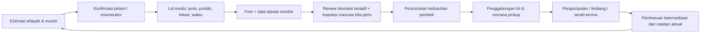

# Rancangan Produk dan Alur Supply Chain

## 1. Rantai pasok yang didukung

Penerima akhir dapat berupa peternak/pabrik pakan, unit kompos, budidaya jamur, fasilitas bioenergi, atau pengguna residu lain yang telah memeriksa spesifikasi material. Ketersediaan tiap jalur tergantung kondisi setempat dan tidak diasumsikan seragam.

## 2. Aktor dan pertukaran informasi

| Tahap        | Pemilik aksi                   | Informasi yang masuk                                                                   | Keluaran                                              |
| ------------ | ------------------------------ | -------------------------------------------------------------------------------------- | ----------------------------------------------------- |
| Perkiraan    | Sistem / analis                | kalender panen, statistik produksi, data geospasial dan penginderaan jauh yang berizin | potensi, periode, rentang ketidakpastian              |
| Konfirmasi   | Petani / kelompok / enumerator | tanaman, tanggal panen, jumlah perkiraan, status lahan                                 | lot terkonfirmasi atau koreksi estimasi               |
| Penilaian    | Petani / enumerator / model    | gambar dan faktor kondisi                                                              | label tentatif dan/atau inspeksi                      |
| Permintaan   | Pembeli                        | jenis residu, jumlah, lokasi, jendela waktu, spesifikasi                               | kebutuhan yang bisa dicocokkan                        |
| Pengumpulan  | Agregator / pengangkut         | kapasitas, rute, jadwal, tarif                                                         | rencana pickup dan status                             |
| Penyelesaian | Kedua pihak                    | jumlah aktual, penerimaan, alasan selisih                                              | data aktual untuk evaluasi dan perencanaan berikutnya |

## 3. Siklus status lot

`draft → ditawarkan → terverifikasi → dicocokkan → dijadwalkan → diambil → diterima/ditolak → selesai`.

Status dapat berakhir sebagai `dibatalkan`, `kedaluwarsa`, atau `perlu inspeksi`. Perubahan menyimpan aktor dan waktu. Penerimaan pembeli merupakan keputusan transaksi; keluaran model bukan sertifikat mutu.

## 4. Konsep pengalaman pengguna

- **Petani:** bahasa sederhana, formulir singkat, satuan lokal yang dikonversi secara eksplisit, opsi bantuan enumerator, lokasi dibagikan hanya sesuai persetujuan.
- **Pembeli:** filter berdasarkan material dan kebutuhan nyata; tampilkan ketidakpastian jumlah, bukti mutu, serta syarat yang belum diverifikasi.
- **Operator:** peta/daftar area, status lot, rencana pickup dan selisih estimasi-aktual.
- **Reviewer:** antrean gambar, panduan label, alasan koreksi dan jejak audit.

## 5. Rancangan grade dan keluaran mutu

Tidak ada definisi grade universal yang diasumsikan. Untuk MVP, gunakan label ordinal yang disepakati buyer/pakar pada pilot, misalnya `layak untuk spesifikasi buyer`, `butuh pemeriksaan`, `tidak sesuai spesifikasi buyer`. Label ini bersifat contoh skema, bukan standar industri. Pisahkan label residu/crop type dari label kondisi/kecocokan.

Setiap prediksi menampilkan: label, confidence terkalibrasi bila tersedia, fitur yang diinput, indikasi kualitas gambar, timestamp, dan penjelasan bahwa keputusan penerimaan tetap pada pembeli/inspektur. Jika data hilang atau confidence rendah, model abstain.

## 6. Strategi data dan multimodal fusion

### Citra

Foto lot dengan panduan jarak/pencahayaan dan referensi skala jika memungkinkan. Ekstraksi citra mendukung pengamatan tampilan/warna, keseragaman, benda asing tampak, dan kondisi permukaan; fitur visual tidak cukup untuk menyimpulkan kadar air atau keamanan tanpa alat ukur.

### Tabular

Jenis residu/crop, varietas (bila diketahui), tanggal panen, lama sejak panen, kondisi penyimpanan (terbuka/tertutup, kontak tanah, paparan hujan), lokasi umum, ukuran lot, metode ukur, pengukuran kelembapan bila tersedia, serta identitas annotator dan tingkat keyakinan label.

### Fusion

Bandingkan tiga eksperimen pada split data yang sama: (1) tabular-only, (2) image-only, (3) multimodal. MVP dapat menggabungkan embedding citra dan fitur tabular setelah baseline masing-masing; gunakan late fusion untuk prototipe yang lebih mudah diaudit. Uji data hilang dengan model per-modality atau fallback yang eksplisit. Split berdasarkan petani/lahan/waktu untuk mencegah kebocoran foto berulang.

## 7. Batas rancangan

Model satelit hanya memperkirakan potensi berdasarkan pola wilayah dan musim. Pengukuran lapangan dan data transaksi aktual membentuk ground truth. Rekomendasi rute tahap MVP dapat berupa heuristik jarak dan jendela waktu; optimasi skala lanjut memerlukan kapasitas kendaraan, jalan, tarif, dan kendala waktu yang benar.
