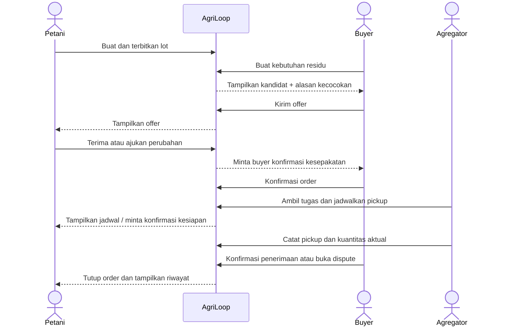

# Arsitektur Web AgriLoop AI — Next.js

## 1. Tujuan

Rancangan ini mendukung dua pengalaman yang berbeda:

1. **Walkthrough publik `/demo`:** memperlihatkan alur bisnis lintas peran dan beberapa grid simulasi di Punjab, tanpa login dan tanpa transaksi nyata.
2. **Workspace pengguna:** dashboard terpisah untuk Petani, Buyer, Agregator, dan Admin. Tiap role mengerjakan tugas bisnisnya melalui route sendiri. Saat web dipakai sebagai produk, route dan mutasi dilindungi autentikasi/otorisasi server.

Grid di `/demo` adalah poligon simulasi. Citra satelit berasal dari Earth Engine dan diekspor lebih dulu. Grid tidak menandai batas lahan sebenarnya, tidak menyatakan adanya stok jerami, dan tidak menyimpan koordinat pribadi.

## 2. Keputusan arsitektur

- **Framework:** Next.js App Router + TypeScript.
- **Render:** Server Components secara default; Client Components hanya untuk interaksi (peta, filter, formulir, animasi).
- **Mode demo:** fixture lot/buyer/grid dan citra statis; perubahan walkthrough tersimpan di localStorage agar role dapat bergantian melihat alur pada browser yang sama. Label simulasi selalu terlihat.
- **Workspace produk:** bila memulai dari kosong, gunakan Supabase Auth dan SSR client resmi untuk Next.js; bila proyek sudah punya auth provider, pakai yang ada. Role bisnis disimpan di tabel aplikasi, bukan di metadata yang bisa diubah pengguna.
- **Database produk:** PostgreSQL/Supabase untuk akun/organisasi, lot, kebutuhan buyer, offer/order, pickup, dan audit. Aktifkan Row Level Security (RLS) pada tabel yang terekspos. Tidak perlu database untuk `/demo`.
- **Earth Engine:** tahap demo memakai komposit yang sudah diekspor. Runtime Next.js tidak memanggil Earth Engine untuk setiap page view.
- **Peta:** satu extent demo dan 4–6 grid tetap dapat ditampilkan dengan raster ringan + SVG overlay; jangan tambahkan map SDK dulu.

Autentikasi membuktikan siapa pengguna; otorisasi memutuskan apa yang boleh dilakukan. Sembunyikan tombol saja tidak cukup. Next.js menganjurkan pengecekan pada Server Components/data-access layer dan setiap Server Action/Route Handler, sementara Proxy hanya cocok untuk redirect optimistis. [Panduan autentikasi Next.js](https://nextjs.org/docs/app/guides/authentication), [Proxy Next.js](https://nextjs.org/docs/app/getting-started/proxy).

Supabase menyediakan Auth dan RLS untuk otorisasi baris. Gunakan pola SSR berbasis cookie untuk Next.js, serta cek role/ownership pada DAL dan kebijakan database. Jangan menyimpan role sensitif pada user-editable metadata atau membuka service-role key ke client. [Supabase SSR](https://supabase.com/docs/guides/auth/server-side), [RLS](https://supabase.com/docs/guides/database/postgres/row-level-security), [RBAC](https://supabase.com/docs/guides/api/custom-claims-and-role-based-access-control-rbac).

## 3. Diagram arsitektur

```mermaid
flowchart TB
  subgraph Public[Publik]
    LAND[Landing /]
    DEMO[/demo walkthrough]
    SAMPLE[Grid GeoJSON + citra Earth Engine yang sudah diekspor]
    FIX[Fixture lot dan buyer simulasi]
    SAMPLE --> DEMO
    FIX --> DEMO
  end

  subgraph Next[Next.js App Router]
    PAGES[Server Components / route pages]
    CLIENT[Client islands: peta, form, workflow]
    DAL[Data Access Layer: session, role, ownership]
    ACTIONS[Server Actions / Route Handlers]
    PAGES --> DAL
    CLIENT --> ACTIONS
    ACTIONS --> DAL
  end

  subgraph Workspace[Workspace terautentikasi]
    FARM[Petani]
    BUY[Buyer]
    AGG[Agregator]
    ADMIN[Admin]
  end

  subgraph Data[Data produk]
    DB[(PostgreSQL)]
    AUTH[Auth provider / session]
    MEDIA[Media storage berizin - tahap setelah MVP]
  end

  LAND --> PAGES
  DEMO --> CLIENT
  PAGES --> Workspace
  DAL --> AUTH
  DAL --> DB
  ACTIONS --> DB
  ACTIONS -. upload foto tahap lanjut .-> MEDIA
```

## 4. Peta route Next.js

Route group dalam tanda kurung mengelompokkan layout dan **tidak** menjadi bagian URL. Prefix role tetap tampak pada URL. App Router menggunakan struktur folder untuk route dan layout. [Dokumentasi routing Next.js](https://nextjs.org/docs/app/getting-started/layouts-and-pages).

```text
app/
  layout.tsx
  (public)/
    page.tsx                         # /
    demo/page.tsx                    # /demo
    about/page.tsx                   # /about
  (auth)/
    login/page.tsx                   # /login
    signup/page.tsx                  # /signup
    onboarding/page.tsx              # /onboarding
  (workspace)/
    app/page.tsx                     # /app -> redirect sesuai role
    farmer/
      layout.tsx                     # role guard + sidebar Petani
      dashboard/page.tsx             # /farmer/dashboard
      supply/page.tsx                # /farmer/supply
      supply/new/page.tsx            # /farmer/supply/new
      supply/[lotId]/page.tsx        # /farmer/supply/:lotId
      offers/page.tsx                # /farmer/offers
      collections/page.tsx           # /farmer/collections
      profile/page.tsx               # /farmer/profile
    buyer/
      layout.tsx
      dashboard/page.tsx             # /buyer/dashboard
      requirements/page.tsx           # /buyer/requirements
      requirements/new/page.tsx       # /buyer/requirements/new
      marketplace/page.tsx            # /buyer/marketplace
      marketplace/[lotId]/page.tsx    # /buyer/marketplace/:lotId
      matches/page.tsx                # /buyer/matches
      orders/page.tsx                 # /buyer/orders
      orders/[orderId]/page.tsx       # /buyer/orders/:orderId
      profile/page.tsx
    aggregator/
      layout.tsx
      dashboard/page.tsx             # /aggregator/dashboard
      available-lots/page.tsx         # /aggregator/available-lots
      collections/page.tsx            # /aggregator/collections
      collections/new/page.tsx        # /aggregator/collections/new
      collections/[collectionId]/page.tsx
      routes/page.tsx                 # /aggregator/routes
      profile/page.tsx
    admin/
      layout.tsx
      dashboard/page.tsx             # /admin/dashboard
      users/page.tsx                  # /admin/users
      areas/page.tsx                  # /admin/areas
      grid-samples/page.tsx           # /admin/grid-samples
      transactions/page.tsx           # /admin/transactions
      data-quality/page.tsx           # /admin/data-quality
      audit-log/page.tsx              # /admin/audit-log
  api/
    lots/route.ts
    requirements/route.ts
    offers/route.ts
    orders/route.ts
    collections/route.ts
    grid-samples/route.ts             # metadata sampel saja
lib/
  supabase/client.ts                  # browser client untuk fitur publik/non-sensitif bila perlu
  supabase/server.ts                  # server client berbasis cookie
  auth/session.ts                     # sesi terverifikasi
  auth/permissions.ts                 # role dan izin organisasi
  dal/lots.ts                         # query lot setelah otorisasi
  dal/orders.ts
  dal/pickups.ts
  demo/store.ts                       # localStorage/fixtures khusus /demo
  validation/                         # validasi input server
supabase/
  migrations/                         # schema + RLS policies
```

Tambahkan subroute detail/edit hanya ketika skenario membutuhkannya. Untuk CRUD MVP gunakan Server Actions dari form bila cocok; gunakan Route Handler untuk API yang memang dipakai beberapa client.

## 5. Route access dan perilaku

| Path                   | Akses                | Fungsi                                                 |
| ---------------------- | -------------------- | ------------------------------------------------------ |
| `/`, `/about`, `/demo` | Publik               | Edukasi, workflow, dan walkthrough tanpa akun          |
| `/login`, `/signup`    | Publik               | Masuk dan membuat akun Petani/Buyer/Agregator          |
| `/onboarding`          | Login, belum lengkap | Profil dasar dan role yang disetujui                   |
| `/app`                 | Login                | Redirect ke dashboard berdasar role utama              |
| `/farmer/*`            | Petani               | Lot sendiri, offer, pickup, riwayat dan profil         |
| `/buyer/*`             | Buyer                | Kebutuhan organisasi, marketplace, offer/order sendiri |
| `/aggregator/*`        | Agregator            | Lot yang ditugaskan/tersedia, pickup dan rencana       |
| `/admin/*`             | Admin                | Konfigurasi, moderasi, data dan audit                  |
| `/api/*`               | Per endpoint         | Sesi, role, ownership/organization diperiksa di server |

`/demo` selalu berjalan mandiri dan tidak menggunakan data produksi. Tombol “Login” membuka workspace; persona switcher hanya ada di mode walkthrough dan bukan otorisasi akun.

## 6. Navigasi dan kemampuan per role

### Petani

Sidebar: Ringkasan, Pasokan, Penawaran, Jadwal pickup, Riwayat, Profil.

- Buat/edit draft lot.
- Terbitkan lot setelah kuantitas, unit, jenis residu, perkiraan tanggal siap dan area terisi.
- Tanggapi offer buyer: terima, tolak, atau ajukan perubahan.
- Konfirmasi kesiapan pickup dan lihat hasil pengumpulan.
- Lihat lot milik sendiri saja.

### Buyer

Sidebar: Ringkasan, Kebutuhan, Cari pasokan, Rekomendasi, Order, Profil organisasi.

- Buat requirement dengan jenis residu, rentang jumlah, jendela waktu, area/radius dan spesifikasi.
- Cari/filter listing yang terbuka; lihat detail yang boleh dibagikan.
- Kirim offer dengan jumlah, syarat/harga opsional, batas berlaku dan catatan.
- Kelola order, konfirmasi jumlah/kondisi diterima, atau buka dispute.
- Melihat order dan requirement organisasi yang berhak diakses.

### Agregator / pengangkut

Sidebar: Ringkasan, Lot tersedia, Pickup, Rencana rute, Riwayat, Profil.

- Lihat order yang memerlukan pickup dan sesuai area/kapasitas.
- Buat pickup plan, pilih lot, tanggal, kapasitas kendaraan dan urutan kunjungan sederhana.
- Perbarui status, catat kuantitas timbang dan waktu, lampirkan bukti pada tahap produk dengan media storage.
- Hanya mengakses pickup yang ditugaskan ke dirinya/organisasinya.

### Admin/operator

Sidebar: Ringkasan, Pengguna, Area, Grid demo, Transaksi, Kualitas data, Audit.

- Setujui role/organisasi; admin tidak dapat dibuat dari pendaftaran publik.
- Kelola konfigurasi area dan metadata grid demo, bukan citra sumber.
- Pantau transaksi, dispute, error data dan jejak perubahan.
- Admin operasional tidak otomatis mendapat akses ke konten privat di luar kebutuhan tugas; aksi sensitif tercatat.

## 7. Alur bisnis lintas role

### Sequence utama



### State machine

- `SupplyLot`: `DRAFT → OPEN → RESERVED → PICKUP_SCHEDULED → PICKED_UP → ACCEPTED → CLOSED`.
- Cabang lot: `REJECTED`, `CANCELLED`, `EXPIRED`, `DISPUTED`; status cabang menyimpan alasan.
- `BuyerRequirement`: `DRAFT → OPEN → PARTIALLY_MATCHED/FULFILLED → CLOSED`, atau `CANCELLED`.
- `Offer`: `PENDING → ACCEPTED/REJECTED/COUNTERED/EXPIRED`; penerimaan offer belum sama dengan order sebelum buyer mengonfirmasi.
- `Pickup`: `PLANNED → CONFIRMED → IN_PROGRESS → COMPLETED`, cabang `RESCHEDULED/FAILED`.
- Status tidak boleh diubah langsung oleh client. Server memeriksa role, ownership, status asal, data wajib, lalu menyimpan perubahan dan audit event secara konsisten.

## 8. Model data minimum

| Tabel              | Field utama                                                                               | Kepemilikan/aturan                                                  |
| ------------------ | ----------------------------------------------------------------------------------------- | ------------------------------------------------------------------- |
| `User`             | id, auth_subject, display_name, status                                                    | Auth identity terpisah dari profile; jangan tampilkan kontak publik |
| `Organization`     | id, name, type, status                                                                    | Untuk buyer/agregator/kelompok tani                                 |
| `Membership`       | user_id, organization_id, role, status                                                    | Role utama dan izin organisasi; admin assignment terbatas           |
| `SupplyLot`        | owner_id, organization_id?, crop, residue_type, quantity, unit, ready_at, area_id, status | Petani/kelompok pemilik boleh edit sesuai state                     |
| `LotObservation`   | lot_id, harvest_date, storage, rain_exposure?, moisture?, observed_by                     | Informasi tambahan; nilai ukur mencatat metode/sumber               |
| `BuyerRequirement` | organization_id, residue_type, quantity_min/max, time_window, area/radius, specification  | Buyer organisasi pemilik                                            |
| `Offer`            | lot_id, requirement_id, buyer_org_id, quantity, terms?, expires_at, status                | Pihak hanya melihat offer terkait transaksi                         |
| `Order`            | lot_id, buyer_org_id, farmer_org_id, agreed_quantity, status                              | Dibuat setelah kesepakatan dikonfirmasi                             |
| `PickupPlan`       | order_id(s), aggregator_org_id, vehicle_capacity?, planned_at, status                     | Agregator hanya mengelola assignment miliknya                       |
| `PickupRecord`     | plan_id, lot_id, actual_quantity, unit, collected_at, received_at?, evidence_ref?         | Aktual terpisah dari estimasi/listing                               |
| `GridSample`       | grid_id, area_label, geometry, is_simulated, metadata_ref                                 | Sampel publik; metadata sumber satelit                              |
| `AuditEvent`       | actor_id, entity_type/id, action, old/new status, created_at                              | Append-only untuk perubahan bisnis penting                          |

MVP dapat menyimpan `GridSample` dan fixtures demo sebagai file JSON/GeoJSON, tidak harus di database. Foto lot nyata dan pembayaran tidak termasuk fase prototipe awal.

Untuk default Supabase, `auth.users` menyimpan identitas login; tabel profil/keanggotaan menyimpan role bisnis. Aktifkan RLS, grant minimum dan tulis policy per operasi pada semua tabel yang diakses lewat API. Service key hanya untuk operasi admin server-side yang benar-benar memerlukannya, tidak pernah untuk browser. Jangan mengandalkan klaim client untuk membuktikan role.

## 9. Arsitektur folder aplikasi

```text
app/
  (public)/page.tsx
  (public)/demo/page.tsx
  (auth)/login/page.tsx
  (auth)/signup/page.tsx
  (workspace)/app/page.tsx
  (workspace)/farmer/...
  (workspace)/buyer/...
  (workspace)/aggregator/...
  (workspace)/admin/...
  api/.../route.ts
components/
  layouts/RoleSidebar.tsx
  demo/SatelliteGridDemo.tsx
  demo/PersonaSwitcher.tsx
  farmer/SupplyLotForm.tsx
  buyer/RequirementForm.tsx
  buyer/OfferForm.tsx
  aggregator/PickupPlanForm.tsx
  shared/StatusBadge.tsx
  shared/ConfirmDialog.tsx
lib/
  auth/session.ts
  auth/permissions.ts
  dal/lots.ts
  dal/requirements.ts
  dal/orders.ts
  dal/pickups.ts
  validation/...
  demo/store.ts
data/demo/
  grids.geojson
  lots.json
  requirements.json
  satellite-samples.json
public/satellite/punjab-demo/...
```

Jangan buat abstraction/folder kosong untuk fitur yang belum digunakan. Pisahkan DAL per resource/flow bisnis yang benar-benar punya izin dan query berbeda.

## 10. Pembagian server dan client

- Page/layout/dashboard mengambil data melalui DAL di server.
- DAL memanggil `getCurrentSession()` dan `requireRole()`/`requireOrganizationAccess()` sebelum query sensitif, lalu mengembalikan DTO dengan field minimum.
- Form interaktif menjadi Client Components; mutasi menggunakan Server Actions atau Route Handlers.
- **Setiap** Server Action dan Route Handler memvalidasi ulang session, role, ownership, dan transisi status. Jangan menganggap layout/Proxy sebagai pelindung tunggal.
- Proxy boleh redirect cepat pengguna anonim dari `/farmer/*` dan role salah; pemeriksaan DAL tetap wajib.
- Jangan memuat data privat role ke komponen client yang tidak perlu.

## 11. Grid dan citra Earth Engine

### Data satelit

Koleksi yang direncanakan adalah Sentinel-2 L2A Harmonized, mis. `COPERNICUS/S2_SR_HARMONIZED`. Earth Engine menyediakan surface reflectance, band tertentu beresolusi 10 m dan interval kunjungan sekitar lima hari. Citra adalah indikator pengamatan permukaan, bukan pengukuran kuantitas residu. [Katalog Sentinel-2 SR Harmonized](https://developers.google.com/earth-engine/datasets/catalog/COPERNICUS_S2_SR_HARMONIZED).

### Demo grid

- Buat 4–6 grid kecil pada satu AOI contoh di Punjab, dengan ID stabil (`PB-G01` dst.), geometry, CRS, label area, dan `is_simulated: true`.
- AOI final dipilih setelah memeriksa citra dan memastikan berada di Punjab; jangan mengklaim grid sebagai batas lahan atau menghubungkannya ke petani nyata.
- Tampilkan raster RGB/NDVI yang diekspor dan grid overlay pada extent sama. Pilihan grid mengubah panel/lot simulasi; pilihan bulan mengubah citra komposit.
- Setiap citra memerlukan metadata `dataset`, `date_start/end`, `bands`, `crs`, `resolution`, `cloud_mask`, `composite_method`, `valid_pixel/observation_count`, `asset_path`, dan `data_status`.
- Periode awal: 15 Agustus–30 November 2025; buat komposit bulanan hanya jika observasi valid cukup. Tampilkan `no-data` dengan jujur.
- Citra export publik boleh ada di `public/`; hindari mempublikasikan batas lahan/koordinat privat.

### Ekspor dan akses Earth Engine

1. Analis memilih AOI Punjab dan membangun grid demo di Earth Engine Code Editor.
2. Mask awan/bayangan dan buat komposit RGB serta NDVI per periode.
3. Ekspor raster kecil, optimalkan gambar untuk web, dan simpan provenance dalam JSON.
4. Simpan aset di `public/satellite/punjab-demo/` atau object storage publik/CDN bila ukuran bertambah.
5. Web menyajikan aset, bukan meminta Earth Engine memproses data pada tiap request.

Integrasi live memakai Earth Engine JavaScript API dan service-account/ADC di server saja; project harus memiliki API aktif, terdaftar, dan izin yang benar. Private key tidak boleh masuk browser, repository, atau log. Ini fase berikutnya, bukan syarat grid demo. [Panduan paket JS](https://developers.google.com/earth-engine/guides/npm_install), [service accounts](https://developers.google.com/earth-engine/guides/service_account), [akses Earth Engine](https://developers.google.com/earth-engine/guides/access).

## 12. Walkthrough publik `/demo`

Persona switcher bukan akun dan tidak memberi akses ke route produk. Seluruh state demo disimpan lokal dengan namespace terpisah, misalnya `agriloop-demo-v1`, dan tombol reset menghapus state itu.

1. Pilih persona.
2. Pilih grid/periode dan baca sumber citra.
3. Jalankan langkah untuk persona terpilih.
4. Ganti persona untuk melihat status yang sama dari sisi aktor berikutnya.
5. Selesaikan alur, lihat catatan pickup dan jumlah aktual simulasi.

Fixture harus menandai `isDemo: true`; jumlah/pembeli/pickup tidak dicampur ke dashboard data produksi.

## 13. Privasi dan keamanan

- Role melekat pada Membership yang disetujui; jangan percaya role dari form/client storage.
- Validasi akses saat render data dan saat mutasi; periksa ownership dan organization membership setiap query.
- Admin assignment hanya melalui proses admin yang tercatat.
- Batasi pembagian koordinat persis dan kontak petani sampai ada kebutuhan transaksi dan persetujuan.
- Foto dan bukti lapangan memerlukan storage privat, akses bertanda tangan, batas ukuran/tipe, retention, dan consent sebelum diaktifkan.
- Jangan simpan rahasia Earth Engine atau auth provider di file yang masuk version control.
- Audit event untuk penerbitan lot, offer, order, jadwal, timbang, penerimaan, dispute, pembatalan dan perubahan role.

## 14. Checklist implementasi untuk AI agent

### Fondasi dan navigasi

- [ ] Periksa aplikasi dan pola auth/database yang sudah ada; gunakan ulang bila tersedia.
- [ ] Bila belum ada backend, gunakan Supabase Auth + PostgreSQL; simpan schema, grants dan RLS policies sebagai migration yang bisa diulang.
- [ ] Buat landing `/`, walkthrough publik `/demo`, auth pages, workspace `/app`, dan dashboard per role.
- [ ] Terapkan layout/sidebar yang konsisten tetapi menu sesuai role.
- [ ] Pastikan `/demo` tetap dapat dibuka tanpa akun dan tidak membaca/menulis tabel transaksi.

### Business flow

- [ ] Petani dapat membuat draft, menerbitkan, mengedit, menanggapi offer, dan melihat pickup.
- [ ] Buyer dapat membuat requirement, melihat match dengan alasan, mengirim offer, dan mengelola order.
- [ ] Agregator dapat menerima assignment, menjadwalkan pickup, dan mencatat kuantitas aktual.
- [ ] Buyer dapat mengonfirmasi penerimaan atau membuka dispute.
- [ ] Admin dapat meninjau user, grid, transaksi, kualitas data dan audit sesuai izin.
- [ ] Validasi state machine menolak transisi status ilegal.

### Otorisasi

- [ ] Setiap halaman workspace memeriksa session dan role di server.
- [ ] Setiap Server Action/API memeriksa session, role, ownership/organization, input dan status asal.
- [ ] Pengguna anonim diarahkan ke login; role lain menerima 403/halaman akses ditolak.
- [ ] Admin tidak dapat dibuat lewat pendaftaran publik.
- [ ] Uji silang akses antar-role dan organisasi.

### Grid dan Earth Engine

- [ ] Muat minimal 4 grid GeoJSON simulasi untuk AOI Punjab.
- [ ] Grid selectable; pilihan bulan/layer memperbarui raster dan metadata.
- [ ] Tanggal, sumber, band, resolusi, cloud mask, CRS dan status no-data terlihat.
- [ ] Tidak menurunkan tonase jerami atau grade dari citra.
- [ ] Tidak ada credential Earth Engine di client.

### Kualitas dan pengalaman

- [ ] Badge `DATA DUMMY / SIMULASI` terlihat pada setiap data walkthrough.
- [ ] Loading, empty, error, forbidden dan not-found states dibuat.
- [ ] Layout flat, responsif, navigasi keyboard, labels, contrast, reduced motion.
- [ ] Sediakan reset walkthrough yang tidak menyentuh data workspace.
- [ ] Jalankan lint/build dan uji route/permission setiap role saat implementasi kode.

## 15. Batas MVP dan urutan pengerjaan

1. **Public/demo:** landing, workflow, persona walkthrough, grid Punjab dan data Earth Engine hasil ekspor.
2. **Role workspaces:** auth, dashboards, listing, requirement, offer/order, pickup dan aturan akses.
3. **Operasi:** admin tools, dispute, audit dan quality monitoring.
4. **Integrasi:** live Earth Engine, media nyata, pembayaran, notifikasi eksternal, optimasi rute.

Jangan membuat integrasi live, pembayaran, chat, fleet tracking, atau computer vision sebagai prasyarat flow awal. Tambahkan setelah alur lintas peran dan kebutuhan lapangan tervalidasi.
